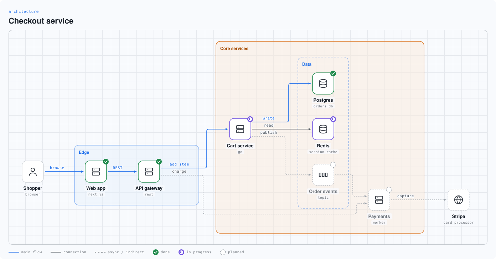
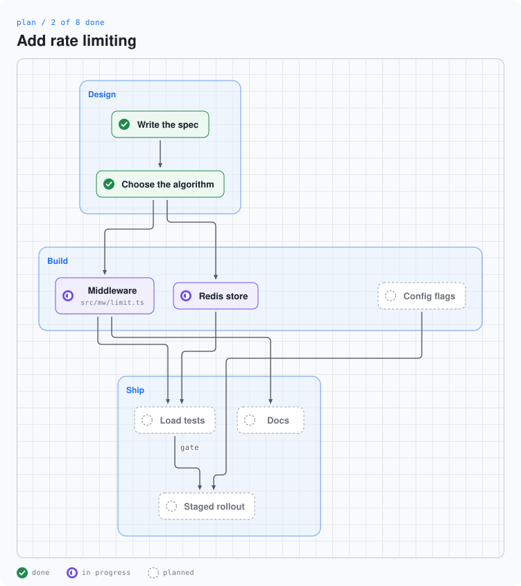
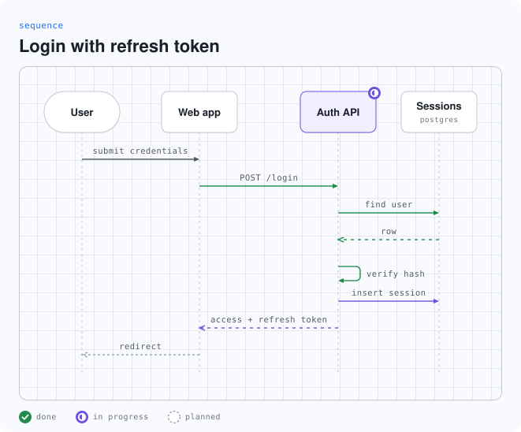

# swe-diagrams

Diagrams of software that an agent draws in seconds.

Ask your agent to show what it built, what it is building, or what it plans.
The agent writes a few lines of text, and swe-diagrams turns them into an
SVG diagram. Each part can show a status: done, in progress, planned, added,
changed, or removed. An architecture node can show the logo of its product.







## Install

### Give it to your agent

Paste this into Claude Code, Codex, Cursor, or another coding agent:

```
Install swe-diagrams for me. Follow the steps in
https://github.com/Benny-Gil/swe-diagrams/blob/main/docs/install.md
```

The agent installs the program and the skill, and draws a test diagram.

### Claude Code plugin

```
/plugin install swe-diagrams --marketplace Benny-Gil/swe-diagrams
```

The plugin gives Claude Code the skill. The skill also needs the program:
install it with one of the next two ways.

### Install script (macOS and Linux)

```bash
curl -fsSL https://raw.githubusercontent.com/Benny-Gil/swe-diagrams/main/install.sh | sh
```

The script puts the program in `~/.local/bin` and the skill in
`~/.claude/skills`. To put the skill in another place, set
`SWE_DIAGRAMS_SKILL_DIR`. To skip the skill, set it to `none`.

### Cargo (all systems)

```bash
cargo install --git https://github.com/Benny-Gil/swe-diagrams swe-diagrams
```

Then copy the folder `skills/swe-diagrams` into the skills folder of your
agent.

### Prebuilt binaries

From version 0.2.0, each [release](https://github.com/Benny-Gil/swe-diagrams/releases)
has binaries for macOS, Linux, and Windows, and a `SHA256SUMS` file.

## Use

Ask your agent, for example:

- "Draw the architecture of this repo."
- "Make a plan diagram for this change, and update it as you work."
- "Show the request path of a login as a sequence diagram."
- "Draw what this pull request adds, changes, and removes."

The agent writes the diagram source and runs `swe-diagrams render`. You get
an SVG file that works in a README, a pull request, or a browser. It has a
light theme and a dark theme.

To write a diagram by hand, read the
[language reference](skills/swe-diagrams/references/language.md).

## How it works

- **Few tokens.** A diagram is 10 to 30 short lines. The agent does not
  write coordinates, styles, or markup.
- **No check loop.** The layout is deterministic. The program prints a
  one-line summary, so the agent does not render an image to check it.
- **Fast.** One diagram takes about 3 milliseconds.
- **Logos.** The program gets a logo the first time a diagram names it,
  from svgl, devicon, or gilbarbara/logos, and keeps it in
  `~/.cache/swe-diagrams/icons`. With `--offline`, it does not use the
  network. It does not change the colours of a logo. The logos are the
  trademarks of their owners.

## Develop

| Folder | Content |
|---|---|
| `rust/` | The program. `cargo test`, `cargo build --release` |
| `skills/swe-diagrams/` | The skill: instructions and the language reference |
| `spec/` | Diagram sources, the expected output, and error cases |
| `docs/` | Install steps and design notes |

To change the output, change the program, run
`UPDATE_GOLDEN=1 cargo test --test golden` in `rust/`, and look at the new
SVG files in `spec/golden/` before you keep them.

## Credits

The look of the diagrams comes from
[stack-diagram](https://github.com/caru-ini/stack-diagram) by caru-ini: the
graph-paper canvas, the logo tiles with the label below, the tinted group
boxes, the colour values, and the rules for edges and labels. The order of
the logo sources comes from that project too. stack-diagram has the MIT
License, Copyright (c) 2026 caru-ini.

swe-diagrams does not include code from that project. The language, the
automatic layout, the status model, and the program are new.

## Versions

The project uses [semantic versioning](https://semver.org). The version is
in `rust/Cargo.toml`, and each release has a git tag such as `v0.1.0`.
[CHANGELOG.md](CHANGELOG.md) lists the changes. Before 1.0, a minor version
can change the language or the SVG output.

## License

MIT. See [LICENSE](LICENSE).
